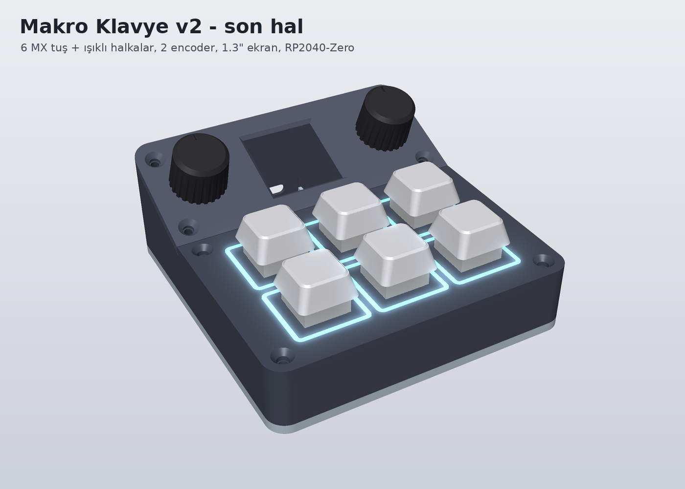

# Makro Klavye v2

RP2040-Zero tabanlı, 1.3" 240x240 ekranlı, 6 tuşlu ve 2 tekerlekli makro klavye.
Kart yazılımı, onu yöneten Windows uygulaması ve 3D baskı dosyaları bu depoda.

Kart yazılımı **3.2**, uygulama **3.2**.

## Neler yapıyor

- **6 tuş, iki komutlu.** Kısa basış ve basılı tutma ayrı komut; basılı tutarken
  karonun çevresinde dolum halkası ilerler. Basılı tutuldukça tekrarlama seçeneği var.
- **Makro dizileri.** Tek tuş sırayla birkaç iş yapar: kısayol, bekleme, metin yazma,
  program açma.
- **16 mod.** Her modun kendi adı, rengi, zemin rengi, tuş düzeni (2x3 karo ya da liste)
  ve grubu olur. Tekerlek aynı gruptaki modlar arasında döner.
- **Ekran.** Tuş haritası, çalan şarkı (albüm kapağı bulanık zemin olarak arkaya yayılır,
  altta gerçek frekans çubukları) ve canlı sistem grafikleri sayfaları.
- **Tuş simgeleri.** 62 hazır simge, uygulamada kendi simgeni çizebilme ve atadığın
  programın simgesini otomatik alma.
- **18 RGB LED.** Mod rengine, müziğe ya da seçtiğin efekte göre; tuşa basınca yayılan dalga.
- **Klavye üstü ayar menüsü.** Parlaklık, ışık, gece modu ve mod kilidi için uygulamaya
  gerek yok.
- **Uygulamadan güncelleme.** Yeni kart yazılımı tek tıkla yüklenir, elle güncelleme
  moduna almaya gerek kalmaz.

## Klasörler

| Klasör | İçerik |
| --- | --- |
| `MakroKeyboardDisplay/` | Windows uygulaması (.NET 10, WinForms) |
| `KartYazilimi/Cpp/MakroKlavye/` | Kartın C++ kaynağı (Arduino, arduino-pico) |
| `KartYazilimi/araclar/` | Yazı tipi ve simge üreten Python betikleri |
| `KartYazilimi/MakroKlavye_3.2.uf2` | Derlenmiş kart yazılımı |
| `3D/baski/` | Baskıya hazır STL dosyaları |
| `3D/testler/` | Tolerans denemeleri |
| `3D/gorseller/` | Bağlantı şeması, LED ve kablo yerleşimi, teknik çizim |
| `3D/kaynak/` | Parametrik model (Python + manifold3d) |

## Donanım

| Parça | Bağlantı |
| --- | --- |
| Tuşlar (6x MX) | GP6, GP7, GP8, GP14, GP15, GP26 |
| Tekerlek düğmeleri | GP2 (sol), GP5 (sağ) |
| Sol tekerlek (EC11) | A: GP0, B: GP1 |
| Sağ tekerlek (EC11) | A: GP3, B: GP4 |
| NeoPixel (18x WS2812B) | GP27 — 12 taban + 6 tuş |
| Ekran (ST7789 240x240) | SPI1: SCK GP10, MOSI GP11, DC GP9, RST GP12, arka ışık GP13 |

Ayrıntılı şema ve kablo yolları için `3D/gorseller/` klasörüne bakın.

## Kurulum

### Kart yazılımı

İlk yüklemede kartı BOOT tuşuna basılı tutarak takın, `RPI-RP2` sürücüsü açılınca
`KartYazilimi/MakroKlavye_3.2.uf2` dosyasını kopyalayın.

Sonraki güncellemeler uygulamadan yapılır: **Ayarlar → Klavye → Kart yazılımını yükle**.
Elle yapmak isterseniz iki tekerlek düğmesine 1 sn basıp (kilit), ardından 1. ve 6. tuşa
3 sn basın; kart güncelleme moduna geçer.

### Kaynaktan derleme

**Kart:** Arduino IDE ya da arduino-cli, `arduino-pico` çekirdeği, kart olarak
`waveshare_rp2040_zero`, USB yığını Pico SDK. Gereken kütüphaneler:
`Adafruit_NeoPixel` ve `ArduinoJson`.

**Uygulama:** Visual Studio 2022+ ile `MakroKeyboardDisplay.slnx` dosyasını açıp derleyin.
.NET 10 gerekir. NuGet paketleri: `System.IO.Ports` ve `NAudio.Wasapi`.

### 3D baskı

`3D/BASKI_NOTLARI.txt` dosyasında her parçanın baskı yönü, adedi ve malzemesi yazıyor.
Taban ve halka difüzörler şeffaf PETG, gerisi istediğiniz filament. Hiçbir parça destek
gerektirmiyor.

## Flash düzeni

| Yer | İçerik |
| --- | --- |
| 0 – 160K | Program |
| 512K – 768K | Kullanıcının çizdiği simgeler (512 adede kadar) |
| 896K – 1020K | Modlar (JSON, 20 KB'a kadar) |
| 1020K – 1024K | Ayarlar |

Kart iki çekirdeği de kullanıyor: birinci çekirdek tuşları, tekerlekleri, USB'yi ve
LED'leri sürüyor, ikinci çekirdek ekranı çiziyor ve SPI'dan gönderiyor.

## Yedek

Uygulamadan alınan yedekler `.tmk` uzantılıdır; modlar, çizilen simgeler, ışık ve ekran
ayarları tek dosyada durur.

## Lisans

Yazılım MIT ([LICENSE](LICENSE)), 3D modeller ve görseller CC BY-SA 4.0
([3D/LICENSE](3D/LICENSE)).
